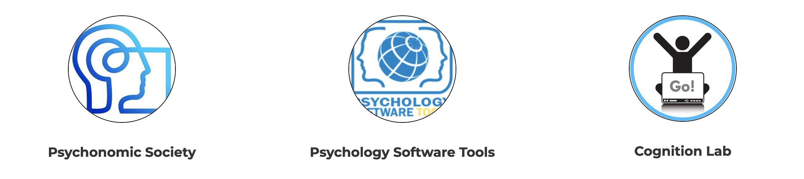

### 2026 Conference Information

The 56th annual meeting of the Society for Computation in Psychology (SCiP) will be held **in person on Thursday, November 19, 2026, in San Diego**, before the opening of the annual meeting of the [Psychonomic Society](https://www.psychonomic.org/page/2026annualmeeting). Abstract submissions are now closed, and we look forward to a great program!

The theme for this year’s conference is *Scaling Up Cognition: Team Approaches to Cognitive Science*. In a time when the questions we ask about cognition are increasingly complex and global, how can we harness the power of big-team science to study cognition at a scale that no single researcher or lab could achieve alone?

**Registration:** [Register and pay for the meeting here](https://www.paypal.com/donate/?hosted_button_id=D4PN39CWFS4NE). At least one author on each accepted submission must register to present. 

**Program:** View the [draft conference program](https://docs.google.com/document/d/1Zke2S3AjiDjf0Xvocvhyfvms8pqq_e0kBM86bpV_Xpc/edit?usp=sharing) for the schedule and session details.

**Steering Committee elections:** Learn more about the nomination process and voting on our [governance page](https://computationinpsych.com/governance/).

### 2026 Student Award Information

First-time graduate student presenters are strongly encouraged to submit abstracts. If you are a first-time graduate student attending SCiP, and the primary presenter, you may be eligible to have your registration waived as part of the *Birnbaum Scholarship* for first-time graduate presenters. Please contact our Executive Director, Erin Buchanan at compinpsych@gmail.com for details. 

The Society sponsors The Castellan Student Paper Award for the outstanding student paper. Student papers should consist of a brief introduction, methods, and results *(up to 3000 words, excluding references, tables, figures, and a title page)*. Student papers on the application of computers to any area of psychology (theoretical, experimental, applied) are welcome. Eligibility is open to work done by a student currently enrolled in undergraduate or graduate courses, or work done as part of a course, thesis, or other student research by a person who graduated within the last year. The student must be the primary author and the presenter of the paper. The winning author will receive a one year membership in the Society and a $200 cash prize. Complete manuscripts for the competition were due *October 15th, 2026*. The award for the outstanding student paper will be announced after the conference. 

## Conference Supporters 

```{r echo = F, fig.align='center', fig.alt="SCiP Sponsors", out.height="80%"}

```

<center>
[Psychonomic Society](https://www.psychonomic.org/) &nbsp; &nbsp; &nbsp; 
[Psychology Software Tools](https://pstnet.com/) &nbsp; &nbsp; &nbsp; 
[Cognition Lab](https://cognitionlab.com/)
</center>

## Past Programs

Use the following links to download our available programs. If you have a past program we do not have included please [email it](mailto:compinpsych@gmail.com) to us! 

- [SCiP in the 1970s](https://github.com/Society-for-Computation-in-Psychology/Society-for-Computation-in-Psychology.github.io/raw/master/files/programs/scip70.zip)
- [SCiP in the 1980s](https://github.com/Society-for-Computation-in-Psychology/Society-for-Computation-in-Psychology.github.io/raw/master/files/programs/scip80.zip)
- [SCiP in the 1990s](https://github.com/Society-for-Computation-in-Psychology/Society-for-Computation-in-Psychology.github.io/raw/master/files/programs/scip90.zip)
- [SCiP in the 2000s](https://github.com/Society-for-Computation-in-Psychology/Society-for-Computation-in-Psychology.github.io/raw/master/files/programs/scip00.zip)
- [SCiP in the 2010s](https://github.com/Society-for-Computation-in-Psychology/Society-for-Computation-in-Psychology.github.io/raw/master/files/programs/scip10.zip)
- [SCiP in the 2020s](https://github.com/Society-for-Computation-in-Psychology/Society-for-Computation-in-Psychology.github.io/raw/master/files/programs/scip20.zip)